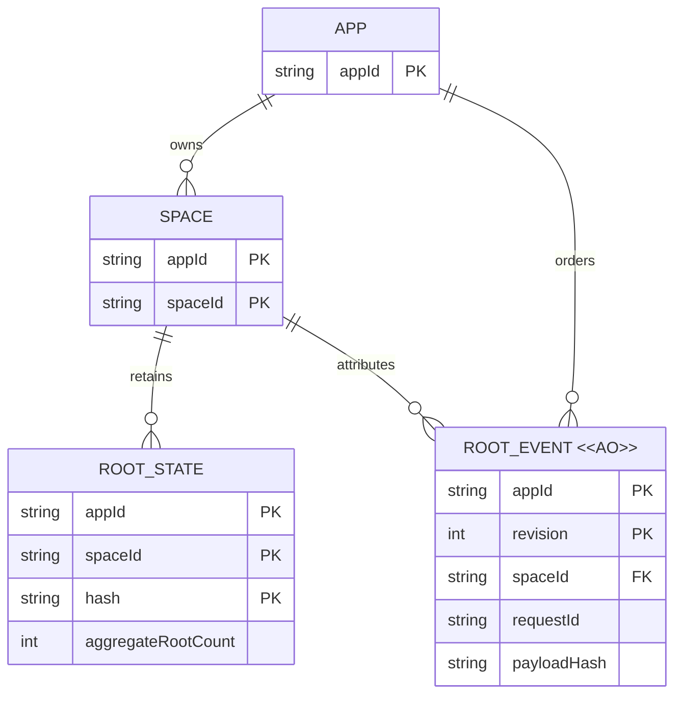

# Root Ref 业务模型评审

## 请求决定

- 是否删除 `refDomain`，直接以 App 与 Space 划分 Root Ref 权限和状态？
- 是否接受 App-global 审计 revision 与 App+Space 请求幂等的破坏性契约变化？
- 是否接受旧流只读归档、新流从明确 checkpoint 开始，而非合并历史？

## 主要变化

| 当前 | 目标 | 原因 |
| --- | --- | --- |
| capability claim 选择 domain，Root Ref 操作额外要求该 claim | App、Space selector 与精确 permission 决定权限 | 去掉不参与数据所有权的额外命名维度 |
| projection 按 App+domain+Space+hash 隔离 | App+Space+hash projection | 与权威 aggregate 状态对齐 |
| 每个 App+domain 一条 revision 流 | 每个 App 一条跨 Space revision 流 | 管理审计不再枚举 domain |
| App+Space+domain+requestId 幂等 | App+Space+requestId 幂等 | 同一 App 的 Space 内重放边界明确 |

当前事实依据：
[D1 baseline](../../../../../../packages/service-cloudflare/migrations/app-space/0001_baseline.sql)、
[Root Ref 内核](../../../../../../packages/service/src/root-refs.ts)、
[公开契约](../../../../../../packages/space-protocol/src/space-contract.ts)。
物理表与实现方式在实施阶段确定，本图不预设 DDL。

## 目标模型：谁拥有状态，谁拥有审计？

`ROOT_STATE` 表示已有节点上的权威 aggregate，不要求新增业务实体或重复存储。
projection 是派生读模型，不另画为权威实体。请求幂等记录是操作记录，
以 `(appId, spaceId, requestId)` 唯一，保存 payload hash 与原 revision。
审计 revision 表示 App 内的审计顺序，不承诺 App-global 物理提交顺序。

## 生命周期与关键规则

| 对象 | 可变性与结束条件 | 删除规则及意义 |
| --- | --- | --- |
| ROOT_STATE | 原子 delta 更新非负 aggregate；沿用现有节点回收条件 | 仅依现有 lease、child reference 与 GC 规则回收，迁移不释放 root |
| ROOT_EVENT `<<AO>>` | 新写入只追加，不覆盖已记录的归属、revision 或 payload | 正常业务不更新或删除；独立保留策略须在部署前确定 |
| 幂等记录 | 首次成功绑定 payload 与 revision；重放不再次执行 delta | 保留与退休策略须明确，不得无证据缩短重放保障 |
| 旧 ledger archive | 切换后只读，不参与新授权、写入、projection 或 GC | 到明确运维保留期限且有证据后才允许清理 |

1. App 是授权与审计主体，Space 是节点与 aggregate 的数据边界；普通 node
   permission 不隐含 Root Ref authority。
2. delta、projection、事件、revision 与幂等结果必须保持原子一致；
   非负 aggregate、ready-node 检查和 uncertain-response replay 继续成立。
3. 同一 App+Space+requestId 的相同 payload 返回原 revision，不同 payload
   稳定冲突；跨 Space 可复用 requestId。
4. App-global revision 单调且不重复，竞争必须可重试；审计流不进入 GC 正确性路径。
5. 管理 API 按 App 查询 projection 和 events，事件保留 Space、requestId、
   payload hash、canonical changes 与时间；删除 domain discovery 和 domain path。

## 迁移与待定事项

- 切换前逐项核对各 Space 的旧 domain projections 之和与权威 aggregate。
  发现漂移即阻止切换并调查，不改写 aggregate；新 projection 以权威状态为基线。
- 旧 per-domain 流不存在可证明的跨 domain 全序，不重编号伪造合并历史。
  新流从记录在案的 checkpoint 开始，历史保留于只读 archive。
- 必须检测旧 domain 在同一 App+Space 复用 requestId 的冲突。
  冲突处置及旧请求重放桥接策略在实施前明确，并由迁移验证证明，禁止静默覆盖。
- 新服务短期可忽略 capability v2 token 上多余的旧 claim，但不得据此改变授权、
  审计或幂等；新 issuer、类型和文档不生成它。遗留 query/body/header 不能重建 domain。
- 实施阶段确定并验证存储原子性、分页 snapshot 与竞争重试方案；部署前确定
  写入栅栏、回滚边界、观察窗口、archive 保留期限和兼容退出证据。
- 同步更新 API baseline、changelog、迁移指南、packed consumers、第一方 Spaces
  App 与文档；旧 endpoint 的退休需可观察的使用证据。
- 不在日志、错误、迁移证据或测试 fixture 中保存 bearer token、私有客户数据
  或完整 capability payload。

本次按现有 schema 与契约交叉检查键和归属；本机无可用 Mermaid 渲染器，
图形渲染、标签与交叉线视觉检查尚未完成。

是否接受上述无 domain 的业务边界、幂等键和新旧审计流切换原则？
